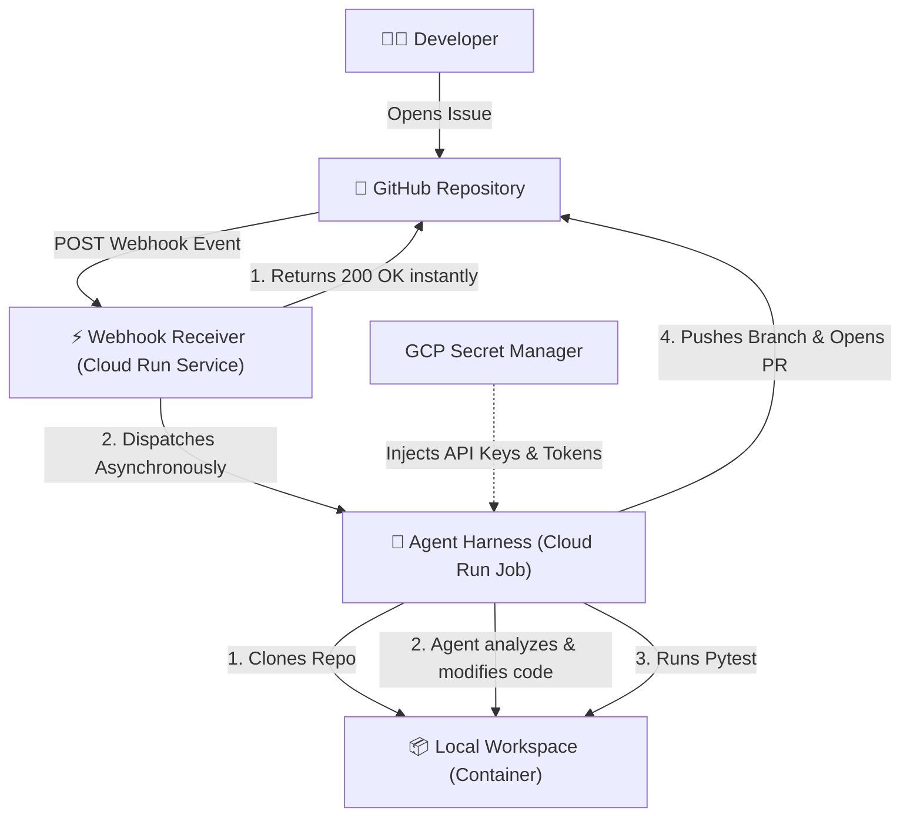

# Autonomous AI Agent Harness (Cloud MVP)

Welcome to the Cloud MVP Autonomous Issue Solver. This project uses the Google Antigravity SDK, Google Cloud Platform (GCP), and GitHub Webhooks to create a fully autonomous AI software engineer.

## Overview
When a developer opens an Issue on GitHub, this system automatically wakes up, clones the repository, reads the codebase to identify the bug, writes a fix, runs unit tests, commits the changes, and submits a Pull Request back to the developer for review.

## Architecture

## Component Directory

The project is structured into three decoupled components. **Click into each component's README for specific documentation and run commands.**

1. [**docker_harness_project/**](docker_harness_project/README.md)
   - The core AI Agent container. Uses the Antigravity SDK to safely execute reasoning, file edits, and git operations in an isolated sandbox.
2. [**webhook_receiver/**](webhook_receiver/README.md)
   - A lightweight FastAPI application. Catches GitHub webhook payloads and triggers the heavy Cloud Run Job asynchronously to avoid webhook timeouts.
3. [**terraform/**](terraform/README.md)
   - Infrastructure as Code. Provisions the Service Accounts, Secret Manager secrets, Artifact Registry, and Cloud Run resources securely on GCP.

## Security & Best Practices
- **No Prompt Injection via Shell:** The agent operates without access to raw shell execution (`shell=True` and `RUN_COMMAND` are disabled). It relies entirely on structured Git tools and built-in Antigravity SDK file tools.
- **Least Privilege IAM:** The system runs on a dedicated service account (`ai-harness-sa`) with restricted, resource-level access to Secret Manager.
- **Ephemeral Environments:** All code execution happens inside a stateless Docker container that is destroyed upon job completion.

## Prerequisites
- [Google Cloud CLI (`gcloud`)](https://cloud.google.com/sdk/docs/install) authenticated (`gcloud auth application-default login`)
- [Docker](https://docs.docker.com/get-docker/) installed locally
- [Terraform](https://developer.hashicorp.com/terraform/install) installed locally
- A Google Gemini API Key
- A GitHub Personal Access Token (PAT) with `repo` permissions

## Deployment Flow Summary
1. Populate `terraform/terraform.tfvars` with your project IDs and secrets.
2. Run `terraform apply` to create the GCP infrastructure.
3. Build and push the Docker images for the Harness and Webhook Receiver to the generated Artifact Registry.
4. Set up the Webhook in your target GitHub Repository, pointing to the deployed Webhook Receiver's URL.