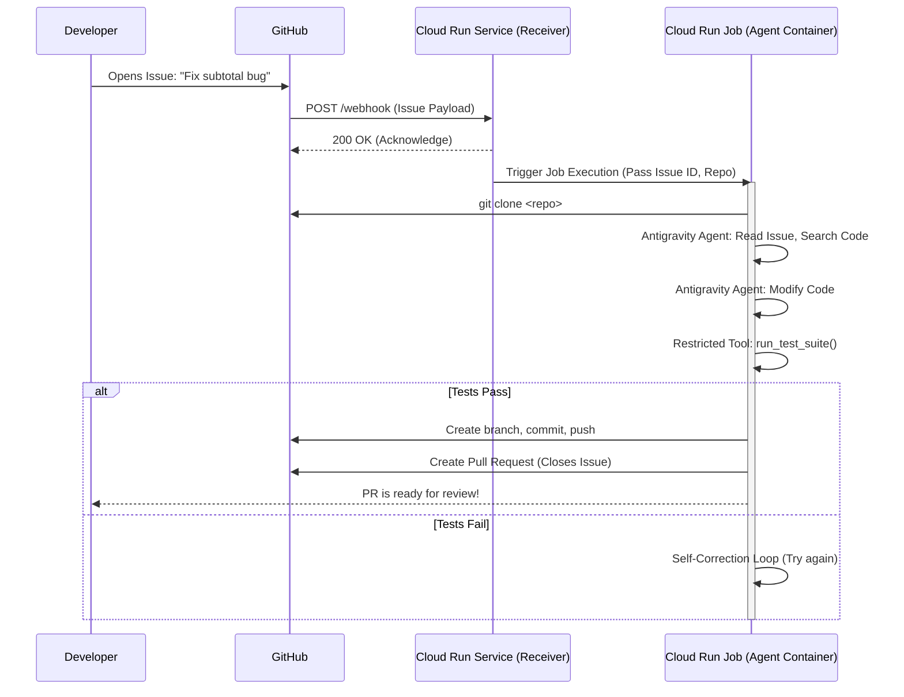

# Containerized AI Evaluation Harness (Antigravity SDK)

A true zero-compromise AI evaluation harness demonstrating how production AI evaluation systems (like SWE-bench and HumanEval) run AI agents 100% jailed inside isolated Docker containers.

## 🌟 Core Architecture

```text
+-----------------------------------------------------------------------+
|                            HOST MACHINE                               |
|  Runs command: docker run -e GEMINI_API_KEY=... bug-hunt-harness      |
+-----------------------------------------------------------------------+
                                   |
                                   v
+-----------------------------------------------------------------------+
|                    DOCKER CONTAINER (ISOLATED)                        |
|                                                                       |
|   1. Harness initializes INSIDE container (/app)                      |
|   2. Agent spawns INSIDE container                                    |
|   3. Agent reads /app/buggy_code.py INSIDE container                  |
|   4. Agent runs pytest & edits files INSIDE container                 |
|   5. Harness evaluates pytest INSIDE container                        |
|                                                                       |
+-----------------------------------------------------------------------+
```

---

## 🚀 How to Run

### Step 1: Build the Container Image
From the `docker_harness_project` directory, build the Docker image:
```bash
docker build -t bug-hunt-harness .
```

### Step 2: Run the Harness inside Docker
Pass your `GEMINI_API_KEY` into the container environment:

**In PowerShell:**
```powershell
docker run --rm -e GEMINI_API_KEY="$env:GEMINI_API_KEY" bug-hunt-harness
```

**In CMD:**
```cmd
docker run --rm -e GEMINI_API_KEY="%GEMINI_API_KEY%" bug-hunt-harness
```

**In Bash:**
```bash
docker run --rm -e GEMINI_API_KEY="$GEMINI_API_KEY" bug-hunt-harness
```

---

## 📁 File Structure

* **[Dockerfile](file:///c:/Users/dhruv.pawar1/POC/harness/docker_harness_project/Dockerfile):** Packages Python 3.11, `pytest`, `google-antigravity`, and all code files into an isolated Linux container environment.
* **[buggy_code.py](file:///c:/Users/dhruv.pawar1/POC/harness/docker_harness_project/buggy_code.py):** Contains a math bug in `calculate_totals()`.
* **[test_buggy_code.py](file:///c:/Users/dhruv.pawar1/POC/harness/docker_harness_project/test_buggy_code.py):** Pytest suite that verifies expected behavior.
* **[harness.py](file:///c:/Users/dhruv.pawar1/POC/harness/docker_harness_project/harness.py):** The in-container orchestrator that initializes the agent, streams its progress, and evaluates `pytest` exit codes inside `/app`.


---

## ☁️ Cloud MVP Architecture: Autonomous Issue Solver

This project serves as a local POC. The next step is a cloud-hosted Minimum Viable Product (MVP) where an AI agent is automatically dispatched to Google Cloud Run when a user opens a new GitHub Issue. 

### Architectural Pillars

1. **Trigger: GitHub Webhooks**
   The target GitHub repository emits a webhook event for `issues` (action: `opened`).
2. **Compute: Google Cloud Run (Service + Jobs)**
   - **Webhook Receiver (Cloud Run Service):** A lightweight API endpoint receives the webhook, extracts the issue context, replies `200 OK` (to satisfy GitHub's 10-second timeout), and triggers the Cloud Run Job.
   - **Agent Execution (Cloud Run Job):** Runs this Docker container. It clones the repo, fixes code, runs tests, and pushes a PR back to GitHub without HTTP timeout constraints.
3. **Output: GitHub API**
   Using a GitHub token, the agent creates a branch, pushes fixes, and opens a Pull Request (`Closes #123`).

### Workflow Sequence



### Next Steps for Development
1. **Phase 1: Update the Docker Container (`harness.py` and `Dockerfile`)**
   - **Install Git:** Modify `Dockerfile` to install `git`.
   - **Dynamic Inputs:** Update `harness.py` to accept `GITHUB_REPO_URL`, `ISSUE_NUMBER`, and `ISSUE_DESCRIPTION` from environment variables.
   - **Repository Initialization:** Add logic to clone the repository.
   - **Output Delivery (PR Creation):** Give the agent a tool to execute `git` commands (or use `PyGithub`) to create a PR.
2. **Phase 2: The Webhook Receiver (Cloud Run Service)**
   - Create a Python web service (FastAPI/Flask) to receive webhooks and trigger the Cloud Run Job asynchronously.
3. **Phase 3: Cloud Deployment**
   - Push updated images to GCP Artifact Registry and deploy to Cloud Run.